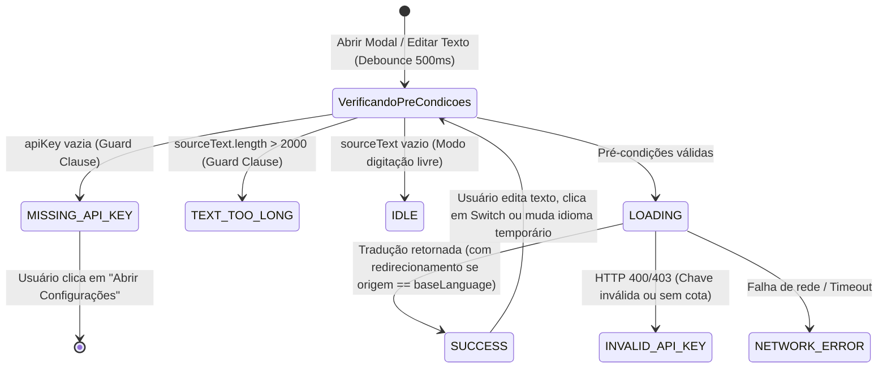

# Data Model: Tradutor Contextual Rápido e Dinâmico

**Feature**: `001-contextual-quick-translator`
**Date**: 2026-11-07

## 1. Entidades Persistentes (`browser.storage.local`)

### `UserPreferences`

Representa as configurações e credenciais persistentes do usuário armazenadas localmente no navegador.

| Campo | Tipo | Padrão Inicial | Regras de Validação e Comportamento |
|-------|------|----------------|-------------------------------------|
| `apiKey` | `string` | `""` | Chave da API do Google Cloud Translation (BYOK). Armazenada com `trim()`. Se vazia (`""`), bloqueia chamadas externas (*Fail Fast*) e aciona o estado `MISSING_API_KEY` no modal. |
| `baseLanguage` | `string` | Idioma da UI do navegador (ex.: `"pt"`, `"en"`, `"es"`, fallback `"pt"`) | Código ISO-639-1 (ou `zh-CN`/`zh-TW`) do idioma mãe/base padrão do usuário. Configurável permanentemente apenas na página de opções. |
| `lastSecondaryLanguage` | `string` | `"en"` (ou `"pt"` se `baseLanguage` for `"en"`) | Código do último idioma estrangeiro utilizado pelo usuário. Atualizado automaticamente quando o usuário traduz de/para um idioma diferente do `baseLanguage`. Usado no redirecionamento inteligente quando o texto de entrada já está no `baseLanguage`. |
| `shortcut` | `string` | `"Alt+T"` | Combinação de teclas configurada para o comando `translate-selection` via `browser.commands`. |

---

## 2. Entidades Efêmeras em Memória (Estado de Execução)

### `TranslationSession`

Representa o estado de uma instância aberta do modal de tradução (no *Content Script* ou no *Popup*). Destruída ao fechar o modal, garantindo que alterações temporárias de idioma nunca sobrescrevam `UserPreferences.baseLanguage`.

| Campo | Tipo | Descrição |
|-------|------|-----------|
| `sourceText` | `string` | Texto atual presente no campo único de entrada editável. Máximo permitido para envio: `2000` caracteres (`MAX_CHARS_PER_QUERY`). |
| `translatedText` | `string` | Resultado da última tradução bem-sucedida exibido na área de resultado. |
| `sourceLanguage` | `string` | Código do idioma de origem selecionado (`"auto"` por padrão para detecção automática, ou código explícito após um *switch*). |
| `detectedSourceLanguage` | `string \| null` | Código do idioma efetivamente detectado pela API quando `sourceLanguage === "auto"`. |
| `targetLanguage` | `string` | Idioma de destino ativo na sessão. Inicializado com `UserPreferences.baseLanguage`, mas alterável temporariamente no seletor do modal ou via *switch*/redirecionamento inteligente. |
| `status` | `SessionStatus` (Enum) | Estado visual do modal: `IDLE`, `LOADING`, `SUCCESS`, `MISSING_API_KEY`, `INVALID_API_KEY`, `TEXT_TOO_LONG`, `NETWORK_ERROR`. |
| `errorMessage` | `string \| null` | Mensagem amigável correspondente ao estado de erro/aviso ativo. |

---

## 3. Constantes e Enums de Domínio (`src/shared/constants.js`)

Seguindo a Constituição (**Constantes ou Enums em vez de números/strings chapados**):

- **`LIMITS`**:
  - `MAX_CHARS_PER_QUERY = 2000` (Limite máximo de caracteres por consulta para proteção de cota BYOK)
  - `TYPING_DEBOUNCE_MS = 500` (Tempo de pausa na digitação antes de disparar tradução automática)
  - `COPY_FEEDBACK_DURATION_MS = 1500` (Duração da confirmação visual de "Copiado!")
  - `ICON_OFFSET_PX = 8` (Distância em pixels entre a seleção e o ícone flutuante)
  - `VIEWPORT_MARGIN_PX = 12` (Margem mínima das bordas da janela para o mini modal)
- **`STORAGE_KEYS`**:
  - `API_KEY = "apiKey"`
  - `BASE_LANGUAGE = "baseLanguage"`
  - `LAST_SECONDARY_LANGUAGE = "lastSecondaryLanguage"`
  - `SHORTCUT = "shortcut"`
- **`SESSION_STATUS`**:
  - `IDLE = "IDLE"`
  - `LOADING = "LOADING"`
  - `SUCCESS = "SUCCESS"`
  - `MISSING_API_KEY = "MISSING_API_KEY"`
  - `INVALID_API_KEY = "INVALID_API_KEY"`
  - `TEXT_TOO_LONG = "TEXT_TOO_LONG"`
  - `NETWORK_ERROR = "NETWORK_ERROR"`
- **`MESSAGE_TYPES`**:
  - `TRANSLATE_TEXT = "TRANSLATE_TEXT"`
  - `OPEN_OPTIONS_PAGE = "OPEN_OPTIONS_PAGE"`
  - `GET_SESSION_BOOTSTRAP = "GET_SESSION_BOOTSTRAP"`
  - `TRIGGER_SHORTCUT_MODAL = "TRIGGER_SHORTCUT_MODAL"`

---

## 4. Transições de Estado da Sessão (`TranslationSession`)

