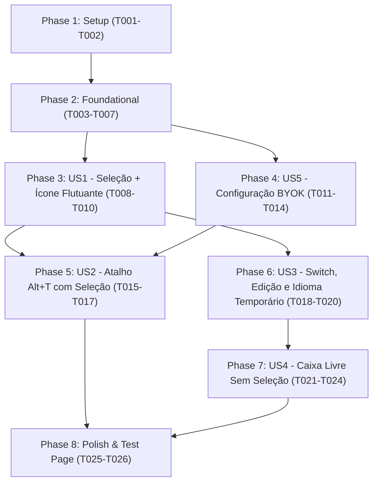

---

description: "Task list for Tradutor Contextual Rápido e Dinâmico implementation"
---

# Tasks: Tradutor Contextual Rápido e Dinâmico

**Input**: Design documents from `/specs/001-contextual-quick-translator/`

**Prerequisites**: plan.md (required), spec.md (required for user stories), research.md, data-model.md, contracts/messaging-and-api.md, quickstart.md

**Tests**: Validação estruturada via página de testes interativa (`tests/manual-test-page.html`) e roteiro `quickstart.md` no Firefox (`about:debugging`).

**Organization**: As tarefas estão agrupadas por fase e User Story (priorizando P1: US1, US5, US2 e em seguida P2: US3, US4) para permitir implementação e validação incremental e independente.

## Format: `[ID] [P?] [Story] Description`

- **[P]**: Pode ser executada em paralelo (arquivos diferentes, sem dependência direta de tarefas incompletas)
- **[Story]**: Rótulo da User Story correspondente (`[US1]`, `[US2]`, `[US3]`, `[US4]`, `[US5]`)
- Todas as tarefas incluem o caminho exato do arquivo a ser criado ou modificado

---

## Phase 1: Setup (Shared Infrastructure)

**Purpose**: Inicialização da estrutura de diretórios da extensão Firefox WebExtensions (Manifest V3) e ativos visuais básicos.

- [X] T001 Criar a estrutura de diretórios do projeto (`assets/icons/`, `src/shared/`, `src/background/`, `src/content/`, `src/popup/`, `src/options/`, `tests/`) e configurar o manifesto Firefox WebExtensions Manifest V3 em `manifest.json` (incluindo permissões `storage`, `activeTab`, `host_permissions` para `https://translation.googleapis.com/*`, comando `translate-selection` com padrão `"Alt+T"`, `background.scripts`, `content_scripts`, `action` e `options_ui`)
- [X] T002 [P] Criar os ícones vetoriais da extensão em `assets/icons/icon-16.svg`, `assets/icons/icon-48.svg` e `assets/icons/icon-128.svg`

---

## Phase 2: Foundational (Blocking Prerequisites)

**Purpose**: Módulos compartilhados de constantes/enums, catálogo de idiomas, persistência em `browser.storage.local` e cliente HTTP base no Background Script.

**⚠️ CRITICAL**: Nenhuma User Story deve ser iniciada antes da conclusão desta fase.

- [X] T003 [P] Implementar todos os Enums e constantes de domínio sem números ou strings chapados em `src/shared/constants.js` sob `globalThis.TranslatorExt`, definindo `LIMITS` (`MAX_CHARS_PER_QUERY = 2000`, `TYPING_DEBOUNCE_MS = 500`, `COPY_FEEDBACK_DURATION_MS = 1500`, `ICON_OFFSET_PX = 8`, `VIEWPORT_MARGIN_PX = 12`), `STORAGE_KEYS` (`API_KEY = "apiKey"`, `BASE_LANGUAGE = "baseLanguage"`, `LAST_SECONDARY_LANGUAGE = "lastSecondaryLanguage"`, `SHORTCUT = "shortcut"`), `SESSION_STATUS` (`IDLE = "IDLE"`, `LOADING = "LOADING"`, `SUCCESS = "SUCCESS"`, `MISSING_API_KEY = "MISSING_API_KEY"`, `INVALID_API_KEY = "INVALID_API_KEY"`, `TEXT_TOO_LONG = "TEXT_TOO_LONG"`, `NETWORK_ERROR = "NETWORK_ERROR"`), `MESSAGE_TYPES` (`TRANSLATE_TEXT = "TRANSLATE_TEXT"`, `OPEN_OPTIONS_PAGE = "OPEN_OPTIONS_PAGE"`, `GET_SESSION_BOOTSTRAP = "GET_SESSION_BOOTSTRAP"`, `TRIGGER_SHORTCUT_MODAL = "TRIGGER_SHORTCUT_MODAL"`) e URLs do Google Cloud
- [X] T004 [P] Implementar o catálogo de idiomas suportados (código ISO-639-1 ou `zh-CN`/`zh-TW` e nomes legíveis em Português) e funções utilitárias de normalização de código de idioma em `src/shared/languages.js`
- [X] T005 Implementar o serviço de armazenamento `UserPreferences` sobre `browser.storage.local` em `src/shared/storage.js` com *Guard Clauses* e inicialização automática de valores padrão: `apiKey` (`string`, padrão `""`, armazenada com `trim()`), `baseLanguage` (`string`, inicializado com o idioma da UI do navegador ex.: `"pt"`, `"en"`, `"es"`, fallback `"pt"`), `lastSecondaryLanguage` (`string`, padrão `"en"`, ou `"pt"` se `baseLanguage` for `"en"`) e `shortcut` (`string`, padrão `"Alt+T"`)
- [X] T006 [P] Implementar o cliente HTTP para a Google Cloud Translation API v2 (`POST https://translation.googleapis.com/language/translate/v2?key={API_KEY}`) em `src/background/api-client.js`, tratando `sourceLanguage === "auto"` (omitindo `"source"` no payload), extraindo `translatedText` e `detectedSourceLanguage`, e mapeando erros `HTTP 400/401/403` para `SESSION_STATUS.INVALID_API_KEY` e falhas de rede/5xx para `SESSION_STATUS.NETWORK_ERROR`
- [X] T007 Implementar o roteador de mensagens no Background Script em `src/background/background.js` para processar `MESSAGE_TYPES.GET_SESSION_BOOTSTRAP`, `MESSAGE_TYPES.TRANSLATE_TEXT` (aplicando *Guard Clauses* / *Fail Fast*: se `apiKey` estiver vazia `""`, retorna `SESSION_STATUS.MISSING_API_KEY` sem requisição externa; se `sourceText.length > 2000` `MAX_CHARS_PER_QUERY`, retorna `SESSION_STATUS.TEXT_TOO_LONG` sem requisição externa) e `MESSAGE_TYPES.OPEN_OPTIONS_PAGE`

**Checkpoint**: Infraestrutura base pronta — implementação das User Stories liberada.

---

## Phase 3: User Story 1 - Tradução Contextual via Seleção de Texto e Ícone Flutuante (Priority: P1) 🎯 MVP

**Goal**: Permitir selecionar qualquer texto em uma página web, exibir um ícone flutuante discreto em `< 150ms` e, ao clicar nele, abrir o mini modal isolado via Shadow DOM com o texto selecionado, idioma detectado, tradução para o idioma base e botão de cópia rápida.

**Independent Test**: Selecionar uma palavra ou frase em uma página web com o mouse, verificar a exibição do ícone flutuante próximo à seleção, clicar nele para abrir o mini modal com a tradução e fechá-lo clicando fora ou pressionando `Esc`.

### Implementation for User Story 1

- [X] T008 [P] [US1] Criar a folha de estilos encapsulada do ícone flutuante e do mini modal (Shadow DOM) em `src/content/widget.css`, garantindo posicionamento dentro do viewport com margem mínima `VIEWPORT_MARGIN_PX = 12`, rolagem interna limpa e controles autoexplicativos (Zero-Manual UX)
- [X] T009 [US1] Implementar o componente `TranslatorWidget` baseado em Shadow DOM (`attachShadow({ mode: 'open' })`) em `src/content/translator-widget.js`, gerenciando o estado `TranslationSession` (`sourceText` com limite de `2000` caracteres `MAX_CHARS_PER_QUERY`, `translatedText`, `sourceLanguage` padrão `"auto"`, `detectedSourceLanguage`, `targetLanguage`, `status` do enum `SessionStatus` e `errorMessage`), renderização do ícone flutuante, abertura do mini modal, cópia rápida com confirmação visual por `COPY_FEEDBACK_DURATION_MS = 1500` e fechamento ao clicar fora ou pressionar `Esc`
- [X] T010 [US1] Implementar a detecção de seleção de texto (`mouseup` / `keyup`), validação de seleção não vazia (*Guard Clause* ignorando espaços em branco e protegendo o cursor em campos `input`/`textarea`), cálculo de coordenadas com `ICON_OFFSET_PX = 8` e integração com `TranslatorWidget` e Background Script em `src/content/content.js`

**Checkpoint**: User Story 1 (MVP de seleção + ícone flutuante + mini modal) funcional e testável de forma independente.

---

## Phase 4: User Story 5 - Configuração e Validação de Chave Própria no Modelo BYOK (Priority: P1)

**Goal**: Disponibilizar a página de opções para cadastro seguro da chave da API do Google Cloud (campo tipo senha + link direto), configuração do idioma mãe/base padrão, e garantir o aviso amigável no modal com botão de abertura imediata das configurações quando a chave não existir ou for inválida.

**Independent Test**: Tentar traduzir sem chave configurada para verificar o aviso *"Para traduzir, insira sua chave da API nas configurações da extensão"* e o botão que abre a página de opções; salvar uma chave no campo tipo senha, reiniciar o navegador e confirmar que a chave persiste e libera as traduções.

### Implementation for User Story 5

- [X] T011 [P] [US5] Criar a interface HTML da página de opções em `src/options/options.html` contendo campo de entrada mascarado (`type="password"`) para a `apiKey` (BYOK), botão de mostrar/ocultar senha, link direto para o console de credenciais do Google Cloud (`https://console.cloud.google.com/apis/credentials`), seletor de `baseLanguage` padrão e seção de atalho de teclado
- [X] T012 [P] [US5] Criar os estilos visuais limpos e responsivos da página de opções em `src/options/options.css`
- [X] T013 [US5] Implementar o controlador da página de opções em `src/options/options.js` para carregar e salvar `UserPreferences` (`apiKey` com `trim()`, `baseLanguage` e `shortcut`) via `src/shared/storage.js`, exibindo feedback visual de confirmação ao salvar
- [X] T014 [US5] Garantir no estado `SESSION_STATUS.MISSING_API_KEY` e `SESSION_STATUS.INVALID_API_KEY` de `src/content/translator-widget.js` a renderização do aviso amigável *"Para traduzir, insira sua chave da API nas configurações da extensão"* acompanhado do botão de ação imediata que envia `MESSAGE_TYPES.OPEN_OPTIONS_PAGE` ao Background Script

**Checkpoint**: Fluxo completo BYOK (bloqueio preventivo *Fail Fast*, aviso amigável no modal, redirecionamento em 1 clique e persistência na página de opções) funcional.

---

## Phase 5: User Story 2 - Tradução Direta por Atalho de Teclado com Texto Selecionado (Priority: P1)

**Goal**: Permitir traduzir instantaneamente qualquer texto selecionado na página pressionando o atalho configurado (padrão `Alt + T`), além de permitir personalizar o atalho nas opções da extensão.

**Independent Test**: Selecionar um texto na página, pressionar `Alt + T` e verificar que o mini modal abre imediatamente exibindo a tradução sem precisar clicar no ícone flutuante; alterar o atalho nas opções e testar o novo atalho.

### Implementation for User Story 2

- [X] T015 [US2] Implementar o listener `browser.commands.onCommand` para o comando `translate-selection` em `src/background/background.js`, enviando a mensagem `MESSAGE_TYPES.TRIGGER_SHORTCUT_MODAL` para a aba ativa (com fallback para `browser.action.openPopup()` caso a aba ativa seja uma página restrita do navegador)
- [X] T016 [US2] Implementar o tratamento de `MESSAGE_TYPES.TRIGGER_SHORTCUT_MODAL` em `src/content/content.js` para que, havendo texto selecionado válido na página, oculte o ícone flutuante e abra imediatamente o mini modal em `src/content/translator-widget.js` disparando a tradução da seleção
- [X] T017 [US2] Adicionar a captura e atualização de atalho personalizado via `browser.commands.update` na página de opções em `src/options/options.js` (persistindo em `UserPreferences.shortcut` com padrão `"Alt+T"` e permitindo restaurar o padrão)

**Checkpoint**: Todas as User Stories de prioridade P1 (US1, US5 e US2) concluídas e integradas.

---

## Phase 6: User Story 3 - Manipulação Dinâmica: Inversão Rápida, Edição e Troca Temporária de Idioma (Priority: P2)

**Goal**: Habilitar no modal o campo único de entrada editável com atualização automática após pausa na digitação (`500ms`), botão de inversão rápida (*switch*) que inverte os idiomas e move a frase traduzida para o campo editável, seletor de idioma de destino temporário por sessão e redirecionamento automático quando o idioma detectado na origem for igual ao `baseLanguage`.

**Independent Test**: Abrir o modal de tradução, clicar no botão *switch* (verificando que a tradução sobe para o campo de entrada e os idiomas invertem), editar o texto (verificando retradução após ~500ms), trocar o idioma de destino temporariamente no modal, fechar e abrir nova tradução confirmando que o idioma base padrão foi preservado.

### Implementation for User Story 3

- [X] T018 [US3] Implementar a regra de redirecionamento inteligente de idioma em `src/background/background.js`: quando o idioma detectado (`detectedSourceLanguage`) ou informado na origem for igual ao `UserPreferences.baseLanguage` e `allowAutoRedirect` estiver ativo, redirecionar automaticamente a tradução para `UserPreferences.lastSecondaryLanguage` (fallback `"en"`, ou `"pt"` se `baseLanguage` for `"en"`) e atualizar `lastSecondaryLanguage` sempre que um idioma estrangeiro for utilizado
- [X] T019 [US3] Implementar no componente `TranslatorWidget` em `src/content/translator-widget.js` a edição no campo único de entrada com *debounce* de `TYPING_DEBOUNCE_MS = 500` e validação em tempo real do limite `MAX_CHARS_PER_QUERY = 2000` (`SESSION_STATUS.TEXT_TOO_LONG`)
- [X] T020 [US3] Implementar no componente `TranslatorWidget` em `src/content/translator-widget.js` a ação do botão de inversão rápida (*switch*) — que inverte `sourceLanguage` (usando `detectedSourceLanguage` se estava em `"auto"`) com `targetLanguage`, move `translatedText` para o campo editável `sourceText` e dispara nova tradução — e o seletor de idioma de destino temporário da `TranslationSession` (sem alterar `UserPreferences.baseLanguage`)

**Checkpoint**: Dinâmica completa de edição, *switch*, idioma temporário e redirecionamento inteligente funcionando no mini modal.

---

## Phase 7: User Story 4 - Caixa de Tradução Livre Sem Texto Selecionado (Priority: P2)

**Goal**: Permitir abrir a caixa de tradução com foco imediato no campo de entrada ao clicar no ícone da extensão na barra de ferramentas ou ao pressionar `Alt + T` sem texto selecionado na página, oferecendo todas as funcionalidades de tradução, *switch*, edição e troca temporária de idioma.

**Independent Test**: Sem nenhum texto selecionado na página, pressionar `Alt + T` (abrindo o modal focado na página) ou clicar no ícone da extensão na barra de ferramentas (abrindo o popup focado), digitar uma frase em qualquer idioma e verificar a tradução automática para o idioma base (ou para o idioma secundário se digitado no próprio idioma base).

### Implementation for User Story 4

- [X] T021 [US4] Atualizar o handler de `MESSAGE_TYPES.TRIGGER_SHORTCUT_MODAL` em `src/content/content.js` e `src/content/translator-widget.js` para que, quando `Alt + T` for acionado sem texto selecionado na página, abra o mini modal posicionado no canto superior direito da área visível (`VIEWPORT_MARGIN_PX = 12`) no estado `SESSION_STATUS.IDLE` com foco automático no campo de entrada editável
- [X] T022 [P] [US4] Criar a estrutura HTML da caixa de tradução da barra de ferramentas em `src/popup/popup.html` contendo cabeçalho de idiomas (origem, botão *switch*, seletor de idioma de destino temporário), campo único de entrada editável com contador de caracteres (`2000`), área de resultado com botão de cópia rápida e banner de aviso BYOK (`MISSING_API_KEY` / `INVALID_API_KEY`)
- [X] T023 [P] [US4] Criar os estilos da caixa de tradução do popup em `src/popup/popup.css` mantendo consistência visual e simplicidade autoexplicativa (Zero-Manual UX) com o mini modal
- [X] T024 [US4] Implementar o controlador da caixa de tradução em `src/popup/popup.js` integrando `GET_SESSION_BOOTSTRAP` (com foco automático no input ou leitura de seleção ativa da aba), tradução automática com *debounce* de `TYPING_DEBOUNCE_MS = 500`, proteção de limite `MAX_CHARS_PER_QUERY = 2000`, botão *switch*, troca temporária de idioma de destino, botão de cópia (`COPY_FEEDBACK_DURATION_MS = 1500`) e botão para abrir a página de opções quando sem chave BYOK

**Checkpoint**: Todas as 5 User Stories (US1 a US5) implementadas e funcionais de ponta a ponta.

---

## Phase 8: Polish & Cross-Cutting Concerns

**Purpose**: Página de testes manuais abrangente, revisão final de código segundo a Constituição e validação do `quickstart.md`.

- [X] T025 [P] Criar a página de testes local em `tests/manual-test-page.html` contendo trechos em múltiplos idiomas (Inglês, Espanhol, Francês, Japonês e Português), campos de formulário (`input` e `textarea`), textos próximos às bordas da janela e um bloco de texto com mais de `2000` caracteres para validar o bloqueio `TEXT_TOO_LONG`
- [X] T026 Realizar revisão geral em todos os arquivos de `src/` aplicando a **Regra do Escoteiro** e verificando conformidade estrita com a Constituição (ausência de números/strings mágicos, uso consistente de *Guard Clauses* / *Return Early* / *Fail Fast* e nomes intencionais)

---

## Dependencies & Execution Order

### Phase Dependencies

- **Phase 1 (Setup)**: Sem dependências — inicia imediatamente.
- **Phase 2 (Foundational)**: Depende da Phase 1 — **BLOQUEIA** todas as User Stories até que constantes, storage, cliente de API e roteador do background estejam prontos.
- **Phase 3 (US1 - P1)** e **Phase 4 (US5 - P1)**: Dependem da conclusão da Phase 2; podem ser desenvolvidas em paralelo pois atuam em diretórios distintos (`src/content/` vs `src/options/`).
- **Phase 5 (US2 - P1)**: Depende da Phase 2 e integra-se com o widget criado na Phase 3 (US1) e a tela de opções da Phase 4 (US5).
- **Phase 6 (US3 - P2)**: Evolui a lógica de tradução do Background (Phase 2) e o componente `TranslatorWidget` (Phase 3).
- **Phase 7 (US4 - P2)**: A criação do Popup (`T022`, `T023`, `T024` em `src/popup/`) depende apenas da Phase 2 e pode correr em paralelo com US1/US2/US3; a tarefa `T021` integra o modo sem seleção ao `TranslatorWidget`.
- **Phase 8 (Polish)**: Executada após a conclusão das User Stories.

### User Story Dependency Graph



---

## Parallel Opportunities & Examples

### Fase Fundacional (Phase 2)
```text
# Podem ser executadas simultaneamente (arquivos independentes):
Task T003: src/shared/constants.js
Task T004: src/shared/languages.js
Task T006: src/background/api-client.js
```

### P1: User Story 1 + User Story 5 em Paralelo
```text
# Equipe/Agente A (Content Script - US1):
Task T008: src/content/widget.css
Task T009: src/content/translator-widget.js
Task T010: src/content/content.js

# Equipe/Agente B (Options UI - US5):
Task T011: src/options/options.html
Task T012: src/options/options.css
Task T013: src/options/options.js
```

### P2: User Story 4 (Popup UI)
```text
# Podem ser executadas simultaneamente:
Task T022: src/popup/popup.html
Task T023: src/popup/popup.css
```

---

## Implementation Strategy

### MVP First (P1 Core: Setup + Foundational + US1 + US5)

1. Concluir **Phase 1: Setup** (`T001`–`T002`)
2. Concluir **Phase 2: Foundational** (`T003`–`T007`)
3. Concluir **Phase 3: User Story 1** (`T008`–`T010`) e **Phase 4: User Story 5** (`T011`–`T014`)
4. **VALIDAR MVP**: Carregar a extensão no Firefox (`about:debugging`), testar o aviso BYOK sem chave, configurar a chave na página de opções e traduzir textos selecionados clicando no ícone flutuante.

### Incremental Delivery

1. Adicionar **Phase 5: User Story 2** (`T015`–`T017`) → Habilita tradução direta com `Alt + T`.
2. Adicionar **Phase 6: User Story 3** (`T018`–`T020`) → Habilita *switch* rápido, edição com *debounce* de `500ms`, troca temporária de idioma e redirecionamento inteligente quando origem == idioma base.
3. Adicionar **Phase 7: User Story 4** (`T021`–`T024`) → Habilita caixa de tradução livre sem seleção (via `Alt + T` e via ícone da barra de ferramentas).
4. Concluir **Phase 8: Polish** (`T025`–`T026`) → Página de testes local e revisão final de código limpo.
